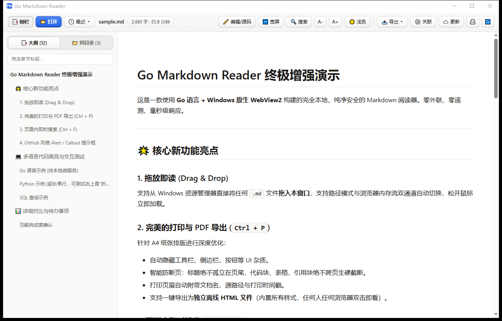
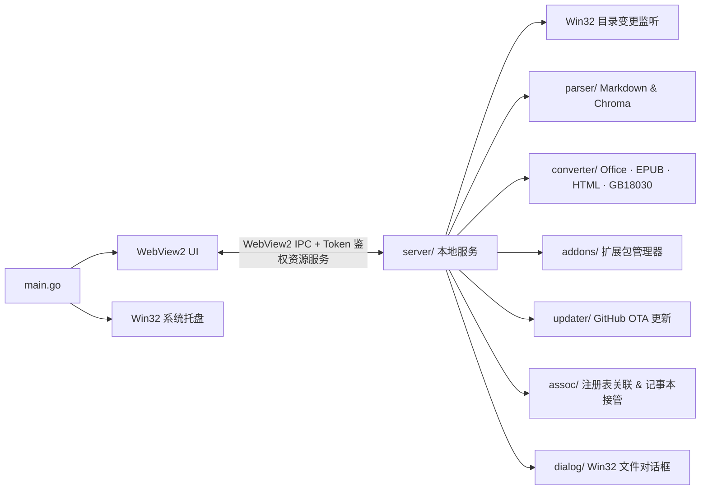

# Go Markdown Reader

轻量、纯本地离线运行的 Windows 全能 Markdown 与文档阅读器，基于 **Go + 原生 WebView2** 构建（单文件可执行程序约 13 MB，无后台驻留常驻扫描，零遥测）。



## 核心特性

### 1. 多格式即开即读与编码兼容
- **Markdown 增强渲染**：基于 `goldmark`，原生支持 GFM 表格/任务列表、脚注、YAML Frontmatter、GitHub Alerts 警示框、`Emoji` 短代码、数学公式（`KaTeX`）、`Mermaid` 流程图、大纲目录（TOC）与文内全文搜索。
- **Office / 电子书 / 网页直读转换**：直接打开或拖入 `.docx`、`.xlsx`、`.pptx`、`.epub`、`.html`/`.htm`、`.csv`/`.tsv`、`.json` 及常见源码/配置文件，自动转为整洁排版视图（表格支持列排序与复制为 Excel TSV）。
- **多编码自动识别**：原生适配 **UTF-8 (含 BOM)**、**UTF-16 LE/BE** 以及中文 Windows 常见的 **GB2312 / GBK / GB18030** 文档，打开不乱码。

### 2. 六套皮肤与可定制阅读外观
- **六种阅读皮肤**：☀️ 浅色、📜 羊皮纸、🌲 护眼绿、🌙 深色、🌌 暗夜蓝灰（Nord）与 🖥️ 跟随系统（实时响应 Windows 深浅色切换）。
- **主题自适应代码高亮**：Chroma 语法高亮采用纯 CSS 类配色，代码、引用块、警示框、滚动条与原生控件随皮肤同步切换。
- **排版微调与持久化**：支持一键切换正文字体（默认黑体 / 书卷衬线）、版面宽度（紧凑 / 标准 / 宽屏）、字号缩放、侧边栏折叠及单文档滚动位置记忆。

### 3. 按需扩展、双栏编辑与系统集成
- **按需扩展包（MIT）**：主程序保持轻量；可在「扩展」面板按需一键安装 `KaTeX` 与 `Mermaid`（强制 SHA-256 校验，装好后完全离线运行）。
- **双栏编辑与一键排版**：内置分屏源码编辑器，支持实时预览与 Markdown / 中英文混排规范化整理（`Ctrl+Shift+F`）。
- **导入导出与打印**：支持另存为 `.md`、导出单文件离线 `.html`、复制源码/纯文本、图片灯箱缩放，以及防断页 A4 打印 / 导出 PDF。
- **Windows 原生集成**：自定义无边框标题栏、Win32 系统托盘、文件变更事件监听（`ReadDirectoryChangesW` 实时热重载）、图形化安装包、文件默认打开方式关联、右键菜单以及一键替换/恢复 Windows 记事本。
- **手动触发 OTA 更新**：内置 GitHub Releases 检查更新、SHA-256 校验与自替换重启流程。

## 常用快捷键

| 快捷键 | 功能 | 快捷键 | 功能 |
| :--- | :--- | :--- | :--- |
| `Ctrl + O` | 打开本地文档 | `Ctrl + B` | 展开 / 收起侧边栏 |
| `Ctrl + E` | 开启 / 关闭源码编辑器 | `Ctrl + S` | 保存当前修改 |
| `Ctrl + Shift + F` | 一键自动排版 | `Ctrl + F` | 页内搜索（`Enter` / `Shift+Enter` 跳转） |
| `Ctrl + P` | A4 打印 / 另存为 PDF | `Ctrl + +` / `-` / `0` | 放大 / 缩小 / 重置字号 |
| `F5` / `Ctrl + R` | 重新加载文档 | `Esc` | 关闭搜索栏或弹窗 |

## 系统架构



## 下载与构建

- **直接下载**：前往 [GitHub Releases](https://github.com/llw2011/go-md-reader/releases) 获取免安装单文件 `go-md-reader.exe` 或图形化安装包 `GoMarkdownReader-Setup.exe`。
- **源码构建与测试**（Windows, `Go 1.26+`, Node.js 用于前端单测）：

```powershell
# 静态检查与全部 Go 单元测试
go vet ./...
go test -count=1 ./...

# 前端逻辑单元测试
node --test ./frontend_test/*.test.mjs

# 编译主程序与图形化安装包
.\build.ps1
```

## 开源协议与致谢

- 本项目基于 [Apache-2.0](LICENSE) 协议开源。
- 所集成与按需使用的 MIT 开源组件详情见 [THIRD_PARTY_NOTICES.txt](THIRD_PARTY_NOTICES.txt)。
