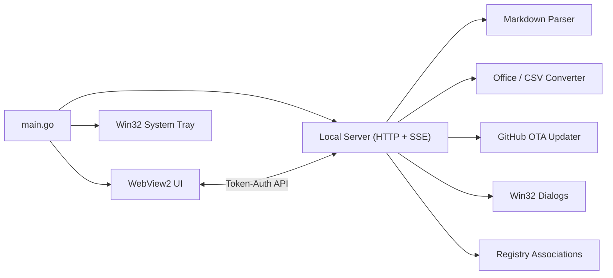

# Go Markdown Reader

Lightweight offline Windows desktop reader for Markdown, source code, and Office files built with Go and native WebView2.

## Features

- Renders GFM Markdown, code highlighting, alerts, TOC, and live reload.
- Converts `.docx`, `.xlsx`, `.pptx`, and `.csv` into readable Markdown.
- Supports drag-and-drop, in-page search, HTML export, and PDF printing.
- Includes Win32 system tray, GUI file-association installer, and GitHub OTA updates.

## Architecture

## Download & Build

- Binaries: [GitHub Releases](https://github.com/llw2011/go-md-reader/releases)
- Build (`Go 1.25+`, Windows): `.\build.ps1`

## License

[Apache-2.0](LICENSE)
